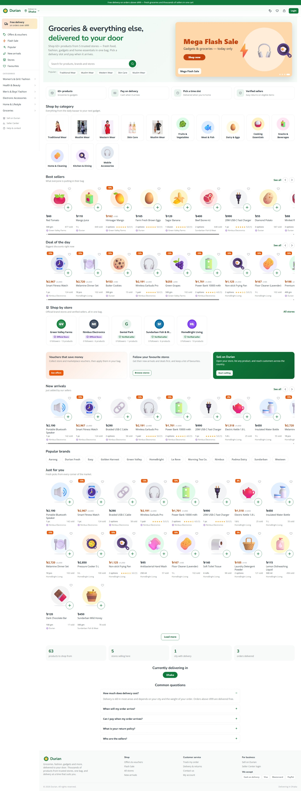
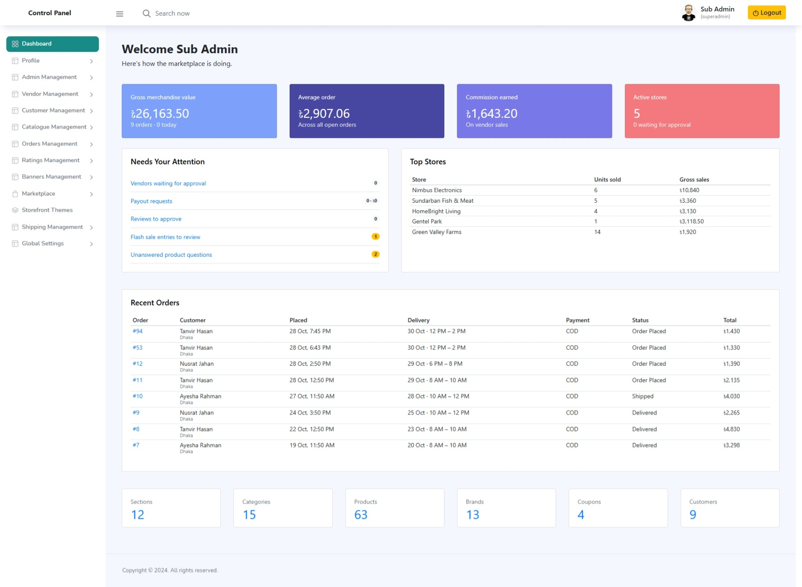
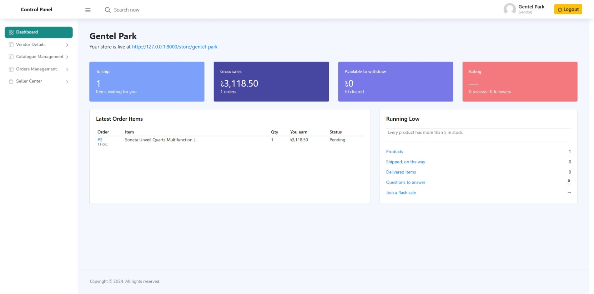
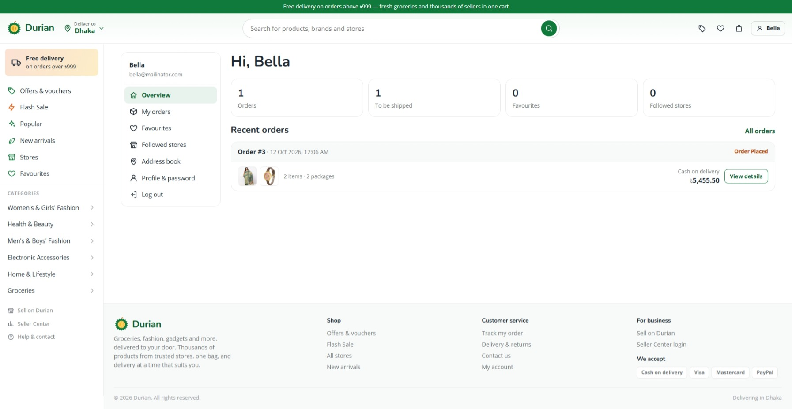

# Durian Marketplace

Durian is a Laravel multi-vendor marketplace for groceries, fashion, electronics, and more. Customers can shop across stores in one cart, while sellers manage their stores and orders through the Seller Center.

## UI Screenshots

### Storefront



### Admin dashboard



### Seller Center



### Customer account



## Features

- Multi-vendor stores, seller profiles, product catalogues, and order management
- Product variants, stock tracking, categories, search, filters, and favourites
- Single-cart checkout with delivery scheduling and per-store order packages
- Flash sales, vouchers, store follows, reviews, and product questions
- Admin tools for marketplace settings, approvals, moderation, and payouts
- PayPal and Iyzico payment integrations, plus a dedicated API

## Tech Stack

- PHP 8.3+ and Laravel 13
- MySQL
- Blade storefront, with Vite for frontend assets

## Run Locally

Requirements: PHP 8.3 or newer, Composer, and MySQL.

```bash
composer install
```

Create `.env` from `.env.example` (use `copy .env.example .env` in PowerShell, or `cp .env.example .env` on macOS/Linux), configure your database, then run:

```bash
php artisan key:generate
```

Create the database and import the provided SQL dump:

```bash
mysql -u root -p -e "CREATE DATABASE durian_db CHARACTER SET utf8mb4 COLLATE utf8mb4_unicode_ci;"
mysql -u root -p durian_db < database/durian.sql
```

The SQL dump includes the original shop tables. Apply the later marketplace migrations as described in the existing migration files; avoid running all legacy migrations against the imported database because they recreate tables already present in the dump.

Start the application:

```bash
php artisan serve
```

The storefront and account pages are available at `http://127.0.0.1:8000`. Admin and seller sign-in is at `/admin/login`; customer sign-in is at `/user/login-register`.

## Tests

```bash
php artisan test --compact
```
